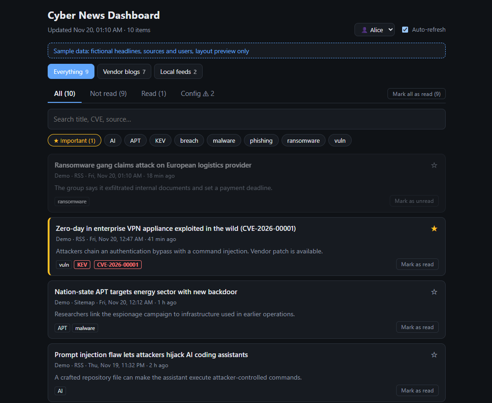
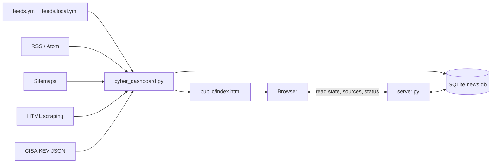

# Cyber News Dashboard

A self-hosted aggregator for cybersecurity news. It pulls articles from RSS feeds, sitemaps and plain HTML pages, enriches them (CVE extraction, CISA KEV flagging, topic tags) and renders a fast, searchable single-page dashboard with read/unread tracking that syncs across your devices.


## Features

- **Many source types, one config file.** Add a site by editing `feeds.yml` or running one command. No code changes.
- **Feed auto-discovery.** Give it a site URL and it finds the RSS/Atom feed (`<link rel="alternate">`, then common paths).
- **Fallbacks for sites without RSS:** sitemap reader (uses `og:title` / `og:description`) and CSS-selector scraper.
- **Enrichment**
  - extracts CVE IDs from titles and summaries
  - flags CVEs present in the [CISA Known Exploited Vulnerabilities](https://www.cisa.gov/known-exploited-vulnerabilities-catalog) catalog (red `KEV` tag)
  - keyword tagging: `ransomware`, `APT`, `vuln`, `breach`, `malware`, `phishing`, `AI`
- **Deduplication** by canonical URL, 30-day history in SQLite.
- **UI:** full-text search, combinable tag filters, dark mode, mobile-friendly.
- **Read tracking:** `All` / `Not read` / `Read` tabs, per-item toggle, "mark all as read" for the current filter.
- **Important flag:** star any news (☆ / ★) and filter the list with `★ Important`. Flagged items are kept past the 30-day retention window.
- **Dates:** every card shows the day and time the article was published, plus its age.
- **Auto-refresh:** a switch in the header. Self-hosted: new items appear as soon as an update finishes, without a reload. Static site: the page reloads every 10 minutes.
- **Config tab:** per-source status (OK / FAILED / never fetched / disabled), last attempt and last success, entries and new items, the exact error message, and a fetch log with an "errors only" filter. In self-hosted mode you can also add, refresh, disable and remove sources from the browser, and set how often all sources are refreshed (10 minutes to 24 hours, or manual only).
- **Users and dashboards (self-hosted):** profiles without passwords. Every user has their own dashboards (named selections of sources, e.g. "A, B, C" or "everything") and their own read / Important flags. The source list is shared. Switch user from the 👤 menu in the header and dashboard from the pills under the tabs, each with its unread count.
- **Two deployment modes:** static site on GitHub Pages, or self-hosted on a Raspberry Pi with cross-device sync and private access over Tailscale.

## Architecture



- `cyber_dashboard.py` collects, deduplicates, enriches and renders a static page.
- `profiles.py` holds the users and dashboards logic (SQLite tables and validation).
- `server.py` (optional, standard library only) serves that page, stores the per-user read and Important flags in the same SQLite file (so every device sees the same state) and runs the built-in scheduler that refreshes the news at the interval chosen in the Config tab.
- Without `server.py` the page falls back to `localStorage` (per browser).

## Quick start

Requires Python 3.9+.

```bash
git clone https://github.com/FluffyFluffer/CTI-news.git
cd cyber-news-dashboard
python3 -m venv .venv && source .venv/bin/activate
pip install -r requirements.txt

python cyber_dashboard.py          # fetch news and build public/index.html
python server.py                   # serve on http://localhost:8080, sync state, refresh news every 60 min (changeable in Config)
```

Preview the UI without network access (fake data):

```bash
python cyber_dashboard.py --sample
```

## Adding sources

Edit `feeds.yml`, or let the tool find the feed for you:

```bash
python cyber_dashboard.py add https://example.com -n "Example Blog"
```

| `type`    | Use it when                          | Fields                                           |
|-----------|--------------------------------------|--------------------------------------------------|
| `rss`     | you know the feed URL                | `url`                                            |
| `auto`    | you only know the site URL           | `url` (feed is discovered on each run)           |
| `sitemap` | the site has no feed but a sitemap   | `url`, optional `url_contains`, `limit`          |
| `scrape`  | plain HTML listing                   | `url`, `item`, optional `title`, `link` (CSS)    |

Every source also accepts `limit` (default 40) and `enabled: false`.

```yaml
- name: Plain HTML news page
  type: scrape
  url: https://example.com/news
  item: "article.post"
  title: "h2 a"
  link: "h2 a"
```

Items without a publication date (scraping) use the time they were first seen. Sitemap mode fetches up to 15 pages per run to stay polite.

## Users and dashboards

Self-hosted mode only. Open **Config** and use the **Users** and **Dashboards** boxes.

- **Users:** add, rename, delete (max 20). A new user gets one dashboard, `Everything`. Existing read / Important flags from older versions are moved to the first user, `Default`, on the first start.
- **Dashboards:** `+ New dashboard`, give it a name and pick the sources it should show from a dropdown (with a filter box and *Select shown* / *Clear shown*, so long source lists stay manageable), or choose *All sources* (it then also follows sources you add later). Nothing is saved until you press **Save**. Max 30 per user, at least one must remain.
- The header shows a 👤 menu once there is more than one user, and pills with unread counts once you have more than one dashboard. The last user and dashboard are remembered per browser.
- Tags, search, tabs and "mark all as read" apply to the current dashboard. Important items older than 30 days are kept and shown in every dashboard that includes their source.

Profiles are **not** a security boundary: anyone who can open the server can switch to any profile (the browser sends it as the `X-User` header). They separate who sees what, nothing more. The static GitHub Pages build has no users or dashboards.

## Config tab

Open the **Config** tab (a `⚠ N` badge shows how many sources failed on their last run).

- **Sources:** status per source, timestamps, entry counts and the error text (`HTTPError: 404 ...`, `no items found - check the CSS selectors`, timeouts, invalid feeds). An update that returns zero items counts as a failure, so dead feeds and broken selectors are visible instead of silent.
- **Log:** the last 150 events (14 days are kept), including a per-run summary and CISA KEV availability.
- **Refresh schedule (self-hosted):** pick how often all sources are fetched: off (manual only), 10, 15, 30 minutes, 1, 2, 4 or 12 hours. The change applies at once and the tab shows when the next update is due. The interval is stored in `news.db`; via the API any value from 10 to 1440 minutes is accepted. A full update (scheduled or "Update now") restarts the countdown; refreshing a single source does not.
- **Static mode (GitHub Pages):** read-only, showing the status from the last build. The schedule there is the cron line in `.github/workflows/update.yml`.
- **Self-hosted mode (`server.py`):** add a source (auto-detect feed, RSS URL, sitemap or HTML scrape), refresh one source or all, enable/disable, remove.

Sources added in the UI are stored in `feeds.local.yml` (machine-managed, git-ignored), which extends and overrides `feeds.yml` by source name. Built-in sources from `feeds.yml` can be disabled but not removed from the UI. Because the local file is not tracked, `git pull` never conflicts with your UI changes.

## Deployment

### Option A: GitHub Pages (public, static)

1. Push the repo to GitHub.
2. **Settings → Pages → Source: GitHub Actions**.
3. The workflow in `.github/workflows/update.yml` rebuilds and publishes the site every hour.

Read state is stored in the browser (`localStorage`) in this mode. Users and dashboards are not available here.

### Option B: Raspberry Pi (private, synced across devices)

Works on any Debian-based system (tested design target: Raspberry Pi OS, alongside Pi-hole).

```bash
sudo apt install -y python3-venv git
git clone https://github.com/FluffyFluffer/CTI-news.git
cd cyber-news-dashboard
bash deploy/install.sh
```

The installer creates a virtualenv, installs one systemd service, runs a first build and starts the server on port `8080` (override with `PORT=9000 bash deploy/install.sh`). The server refreshes the news by itself, so no cron job or timer is needed. Set the interval in the **Config** tab. Re-running the installer after a `git pull` is safe: it also removes the old hourly timer from earlier versions.

Useful commands:

```bash
systemctl status cyber-dashboard
journalctl -u cyber-dashboard -n 50            # server and update output
```

To refresh immediately use **Update now** in the Config tab.

#### Access from your phone with Tailscale

Install [Tailscale](https://tailscale.com/) on the Pi and on your phone (same account). The phone can then reach the Pi from anywhere over an encrypted WireGuard tunnel, without opening any port on your router.

```bash
curl -fsSL https://tailscale.com/install.sh | sh
sudo tailscale up
tailscale ip -4        # the Pi's Tailscale address
```

Then open `http://<tailscale-ip>:8080` (or `http://<pi-name>:8080` with MagicDNS) on the phone.

> **Do not port-forward 8080 to the internet and do not use Tailscale Funnel.** The server has no authentication by design; it is meant for your LAN and your tailnet only.

## Project layout

```
cyber_dashboard.py     collect -> enrich -> store -> render (also the CLI)
profiles.py            users and dashboards (SQLite tables, validation, migration)
server.py              static file + read/important state + source and schedule API + scheduler (stdlib only)
feeds.yml              default sources (tracked in git)
feeds.local.yml        sources added/overridden in the UI (git-ignored, created on demand)
deploy/install.sh      Raspberry Pi installer (systemd)
.github/workflows/     hourly GitHub Pages build
```

### API

Endpoints marked **user** need the header `X-User: <user id>` (400 if missing or malformed, 404 for an unknown user).

| Method | Path        | Body                                     | Result                |
|--------|-------------|------------------------------------------|-----------------------|
| GET    | `/api/read` (user) |                                          | `{"read": [urls...]}` |
| POST   | `/api/read` (user) | `{"urls": [...], "read": true\|false}`   | `{"ok": true}`        |
| GET    | `/api/important` (user) |                             | `{"important": [urls...]}` |
| POST   | `/api/important` (user) | `{"urls": [...], "important": true\|false}` | `{"ok": true}`  |

All POST endpoints require `Content-Type: application/json`, which forces a CORS preflight and prevents other websites from calling them.

| Method | Path                    | Body                                          | Purpose                            |
|--------|-------------------------|-----------------------------------------------|------------------------------------|
| GET    | `/api/config`           |                                               | sources, status, log, `updating`   |
| POST   | `/api/sources`          | `{url, type, name?, url_contains?, item?, title?, link?}` | add a source (`type`: `detect`, `rss`, `sitemap`, `scrape`) |
| POST   | `/api/sources/toggle`   | `{"name": "...", "enabled": true\|false}`     | enable / disable                   |
| POST   | `/api/sources/remove`   | `{"name": "..."}`                             | remove a UI-added source           |
| POST   | `/api/update`           | `{}` or `{"source": "..."}`                   | start an update in the background  |
| GET    | `/api/items[?dashboard=ID]` (user for `dashboard`) |                | items, tags and `updated` (used by auto-refresh); with `dashboard` only that dashboard's sources |
| GET    | `/api/users`            |                                               | `{users: [{id, name}]}`            |
| POST   | `/api/users`, `/api/users/rename`, `/api/users/delete` | `{name}` / `{id, name}` / `{id}` | manage users |
| GET    | `/api/dashboards` (user) |                                              | the user's dashboards with `unread` counts |
| POST   | `/api/dashboards`, `/api/dashboards/update`, `/api/dashboards/delete` (user) | `{name, all, sources}` / `{id, name, all, sources}` / `{id}` | manage dashboards |
| POST   | `/api/settings`         | `{"refresh_minutes": 15}`                     | scheduler interval: `0` (manual only) or 10-1440 |

## Security notes

The server has **no authentication**. It is meant for your LAN and your Tailscale network only. Never port-forward it and never use Tailscale Funnel. Built-in safeguards:

- **SSRF guard:** sources added from the UI must resolve to public addresses. Loopback, private, link-local, CGNAT (Tailscale) and `0.0.0.0` (Pi-hole-blocked) targets are rejected. Override with `ALLOW_PRIVATE_URLS=1` if you really need an internal source. Sources written by hand in `feeds.yml` are trusted and not checked.
- **Host header check (anti DNS-rebinding):** requests are accepted only for IP addresses, single-label names and the suffixes `.lan`, `.local`, `.home`, `.home.arpa`, `.ts.net`. For any other hostname set `ALLOWED_HOSTS=news.example.com,other.name` in the service environment.
- **JSON-only writes** (CORS preflight) and a 1 MB request limit.
- User profiles only separate views; they do not authenticate anyone.
- The write API can change your source list and trigger outbound requests, so keep access limited to devices you trust.

## Roadmap

- importance scoring (KEV, EPSS, ransomware mentions, number of sources covering a story)
- clustering duplicate stories from different outlets into a single card
- MITRE ATT&CK technique and threat-actor extraction
- optional LLM summaries
- tests for collectors with recorded fixtures

## Notes

- Respect each site's terms and `robots.txt`; the scraper and sitemap modes are meant for light, personal use.
- Headlines and summaries belong to their publishers. The dashboard stores short excerpts and always links to the original article.
